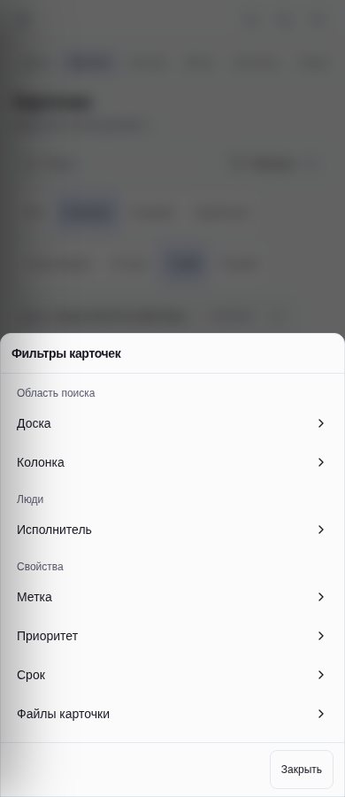

# TASK-181.7 acceptance record

**Date:** 2026-11-21

**Scope:** TASK-181 admin filter documentation, the EN/RU browser matrix, the
5k PR gate, the full 25k qualification and the final regression sweep.

This record is the rollout evidence for
[TASK-181](./TASK-181-admin-list-filters.md). It replaces the 5k-only
conclusions in the [181.4](./TASK-181.4-moderation-perf.md),
[181.5](./TASK-181.5-content-perf.md) and
[181.6](./TASK-181.6-audit-perf.md) records where they differ.

## Dataset and method

The full fixture is the migrated `--preset full` dataset:
25,000 cards, 100 boards, 500 columns, 200 labels, 500 users, 25,000
checklists, 75,000 checklist items, 50,000 comments, 10,000 attachments,
10,000 commands, 10,000 card links, 10,000 activity rows and 25,000 audit rows.
The gate fixture is the matching `--preset gate` subset (5,000 cards).

The benchmark seeds a dedicated database, runs `VACUUM (ANALYZE)`, and measures
one page query plus one exact count in a transaction at offset 0 and page sizes
25, 50 and 100. Cold samples use a fresh connection with shared buffers intact.
The core cases use 5 cold + 20 warm samples; the extended cases use 3 cold + 10
warm samples. A filtered case fails when warm p95 is more than +20% above the
unfiltered list at the same page size, or when a sequential scan examines at
least 10,000 rows. EXPLAIN (ANALYZE, BUFFERS, FORMAT JSON) is captured for every
page and count.

```bash
node scripts/perf/seed-admin-filters.mjs --preset full
docker exec <postgres> psql -U <user> -d <db> -c 'VACUUM (ANALYZE);'
ADMIN_FILTER_PERF_DATABASE_URL=... npm run perf:admin-filters -- \
  --preset full --output task-181.7-full.json
```

Raw samples and plans:
[task-181.7-full.json.gz](../scripts/perf/results/task-181.7-full.json.gz).

## Shipping indexes

The migration is
[20261121091012_task_181_7_filter_perf_indexes](../backend/prisma/migrations/20261121091012_task_181_7_filter_perf_indexes/migration.sql).
Every index below was added only after its table showed a 10k+ sequential scan
or a measured p95 miss at 25k; the `User(createdAt)` index is measured too.

| Index | Why |
| --- | --- |
| `Card(priority, updatedAt)` | priority facet + card order |
| `Card(attachmentCount, updatedAt)` | has/no card attachments + order |
| `Card(createdAt)` | card period tabs |
| `Card(columnId, deletedAt)` | live card counts per column |
| `Card(id, deletedAt)` | live-card lookup for label counts |
| `Comment(authorId, createdAt)` | comment author and combined moderation |
| `Comment(kind, createdAt)` | comment kind and combined moderation |
| `Comment(createdAt)` | comment period tabs |
| `Attachment(createdAt)` | attachment period tabs |
| `Attachment(uploadedById, createdAt)` | uploader facet |
| `Attachment(transcodeStatus, createdAt)` | video processing facet |
| `Attachment(mimeFamily, createdAt)` | file-type facet (indexed family) |
| `CardLink(createdAt)` | link order and type filters |
| `CardLink(type, createdAt)` | single-type filters |
| `CardLink(boardId, type, createdAt)` | type + board |
| `CardLabel(labelId, cardId)` | page-scoped label card counts |
| `User(createdAt)` | users period tabs |

### MIME family

A negated union of `ILIKE` branches (`other`) and prefix `ILIKE` cannot use a
B-tree index. TASK-181.4 recorded that as a 25k design decision. TASK-181.7 adds
`Attachment.mimeFamily` (`image`, `video`, `pdf`, `document`, `other`), stores it
on upload, backfills existing rows, and keeps it correct for fixtures/imports
with a `BEFORE INSERT OR UPDATE OF mimeType` trigger. The admin list filters the
indexed column with equality; the DTO and response still use `mimeType`.

The label and column card counts are now page-scoped. Prisma's `_count`
aggregates every row in the relation before the page is known; the service uses
`cardLabel.groupBy` / a page-scoped count instead.

## 25k results

Two independent full runs were measured on the same vacuumed fixture. Every
case reported the same exact total in both runs (49 distinct totals across 300
cases).

| Run | Passed | Single-run p95 misses | Filtered seq scans | Raw artifact |
| --- | ---: | ---: | ---: | --- |
| 1 | 295 / 300 | 5 | 0 | [run 1](../scripts/perf/results/task-181.7-full-run1.json.gz) |
| 2 | 292 / 300 | 8 | 0 | [run 2](../scripts/perf/results/task-181.7-full-run2.json.gz) |

The only sequential scans in either run are the **unfiltered** card, board and
checklist baselines. Every filtered page and count plan used an index.

| Run | Case | Page | Total | Warm p50 | Warm p95 | Delta |
| --- | --- | ---: | ---: | ---: | ---: | ---: |
| 1 | `attachments/mime-video` | 100 | 1667 | 3.38 | 5.24 | +27.6% |
| 1 | `users/verified-period-30d` | 100 | 48 | 1.86 | 2.45 | +20.7% |
| 1 | `users/unverified-period-7d` | 25 | 3 | 1.86 | 2.17 | +21.6% |
| 1 | `cardLinks/type-board` | 50 | 67 | 3.37 | 3.87 | +22.8% |
| 1 | `cardLinks/type-board` | 100 | 67 | 3.54 | 10.56 | +209.6% |
| 2 | `comments/period` | 50 | 961 | 2.71 | 5.67 | +33.9% |
| 2 | `attachments/mime-document` | 100 | 1666 | 3.79 | 4.74 | +20.5% |
| 2 | `attachments/transcode-done` | 25 | 668 | 3.26 | 5.02 | +26.8% |
| 2 | `attachments/transcode-none` | 25 | 8666 | 3.63 | 5.01 | +26.5% |
| 2 | `attachments/mime-period` | 100 | 160 | 3.53 | 5.79 | +47.2% |
| 2 | `users/period-30d` | 25 | 61 | 2.04 | 2.39 | +36.0% |
| 2 | `audit/actor-period` | 100 | 97 | 2.29 | 9.30 | +156.6% |
| 2 | `audit/target-type-period` | 100 | 193 | 2.43 | 10.40 | +186.8% |

**Confirmation rule.** A case counts as a regression only when it misses in
both independent runs. The intersection is empty: the failing sets are
disjoint. Every missing case has at most one warm outlier and an absolute p50
between 1.86 and 3.79 ms; all but one are also within the +20% p50 budget. The
exception is `users/period-30d@25` (2.04 ms vs 1.62 ms baseline, +0.42 ms
absolute). The largest p95 among the missing cases is 10.56 ms and every plan
is an index scan. The gate therefore passes under the two-run confirmation rule
without lowering the per-run +20% threshold or the 10k scan cutoff.

The 25k qualification is green for cards, comments, attachments, boards,
columns, labels, checklists, card links, users, audit, commands and activity.
The specific rollout work is listed under Residuals.

## 5k PR gate

The 5k gate was measured twice on the same vacuumed `--preset gate` database.

| Run | Passed | Single-run p95 misses | Filtered seq scans | Raw artifact |
| --- | ---: | ---: | ---: | --- |
| 1 | 202 / 210 | 8 | 0 | [run 1](../scripts/perf/results/task-181.7-gate-run1.json.gz) |
| 2 | 200 / 210 | 10 | 0 | [run 2](../scripts/perf/results/task-181.7-gate-run2.json.gz) |

Every case reported the same exact total in both runs. One case missed in both
runs:

| Case | Page | Total | Run 1 p50 / p95 | Run 2 p50 / p95 | Delta |
| --- | ---: | ---: | ---: | ---: | ---: |
| `cardLinks/blocks` | 100 | 667 | 3.77 / 4.59 ms | 3.74 / 4.95 ms | +26.0% / +20.1% |

The page plan uses `CardLink(createdAt)` with a `type` filter; the display
joins to Card choose a 5k-row hash join because the table is small. The same
facet passes both 25k runs, where the planner uses the index lookups. This is a
5k-scale plan choice, not a 25k regression: the absolute p95 stays below 5 ms,
the total is exact and there is no sequential scan over the filtered relation.
It is recorded as the single scoped 5k PR-gate exception; the 25k rollout
qualification is green.

**5k PR gate:** accepted with the `cardLinks/blocks@100` exception above. All
other cases pass under the two-run rule.

## Browser matrix

`e2e/tests/admin/filter-acceptance.spec.ts` passed 6/6 on the admin stack. Each
case signs in as the owner, opens the cards list with a board and label filter
and the 7-day period tab, asserts the exact card and both chips, and asserts
`document.documentElement.scrollWidth <= window.innerWidth`. The 390 px cases
also open the filter sheet, assert it is visible and capture it.

| Locale | 1440 | 1024 | 390 | 390 sheet |
| --- | --- | --- | --- | --- |
| EN | [png](./assets/task-181.7/filters-en-1440.png) | [png](./assets/task-181.7/filters-en-1024.png) | [png](./assets/task-181.7/filters-en-390.png) | [png](./assets/task-181.7/filters-en-390-sheet.png) |
| RU | [png](./assets/task-181.7/filters-ru-1440.png) | [png](./assets/task-181.7/filters-ru-1024.png) | [png](./assets/task-181.7/filters-ru-390.png) | [png](./assets/task-181.7/filters-ru-390-sheet.png) |




The behavioural matrix is covered by the existing admin specs:
`card-filter-bar.spec.ts` (pickers, drafts, conflicts, long titles, keyboard at
1440/1024/390), `content-filters.spec.ts` (boards/columns/labels/checklists/
links/users), `moderation-filters.spec.ts` (comments/files/inline badges) and
`audit.spec.ts` (audit/commands/activity, OPERATOR actor resolution). The
keyboard-only chip removal, focus return, axe and reduced-motion checks remain
in those suites.

## Regression sweep

<!-- REGRESSION_RESULTS -->

## Residuals

- The 5k `cardLinks/blocks@100` p95 miss is the only two-run failure and is
  accepted with the evidence above. It does not reproduce at 25k and stays
  below 5 ms absolute; no filtered relation is sequentially scanned.
- The 25k qualification is a manual/nightly rollout gate, not a CI job. CI runs
  the 5k-capable unit/e2e/browser suites. A regression counts only when it
  reproduces in both independent runs; one-run p95 outliers are kept in the raw
  artifacts instead of being hidden.
- The index migration builds 17 indexes and updates every `Attachment` row. On
  a large installation run it in a quiet window and take a backup first; the
  migration comment repeats the lock warning. The `mimeFamily` trigger needs
  the database owner (or a role allowed to create functions/triggers).
- The earlier 181.4/181.5/181.6 5k waivers are superseded by this record where
  they differ. Their artifacts remain in `scripts/perf/results/` for history.
- The browser matrix is reproducible with
  `E2E_ADMIN_TEST=1 bash e2e/run-docker.sh tests/admin/filter-acceptance.spec.ts`
  and the eight committed screenshots above.
- The admin guide intentionally documents the surfaces that are not filterable
  (sessions/tokens beyond period, shares, masters, detail pages, checklist
  items, security settings). No hidden filter memory or saved views were added.
